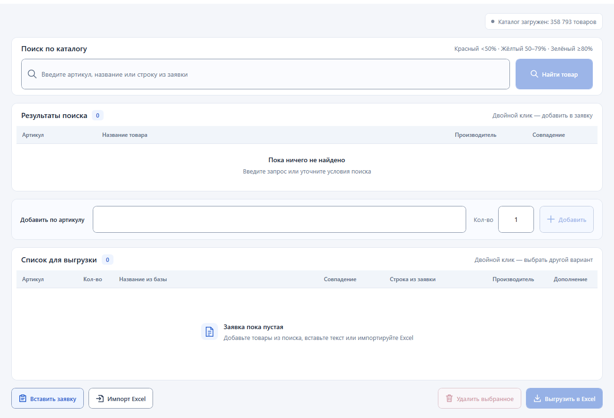

# ProductFinder

**Помощник для подбора товаров и подготовки заявок.**

ProductFinder — Windows-приложение, которое ускоряет работу с товарным каталогом: находит позиции по артикулу и названию, обрабатывает заявки из текста и Excel, помогает проверить сомнительные совпадения и выгружает результат в Excel.

Программа предназначена для работы специалиста: автоматизирует повторяющиеся действия, но не заменяет окончательную проверку выбранного товара.

---

## Возможности

### Поиск и подбор

- Поиск по артикулу, названию и тексту строки заявки.
- Работа с локальным каталогом SQLite.
- Асинхронная загрузка каталога и поиск без блокировки интерфейса.
- Кэширование подготовленного каталога для ускорения повторных запусков.
- Отображение производителя и оценки совпадения.
- Проверка распознаваемых моделей, марок и технических параметров.
- Подсветка сомнительных результатов с объяснением причин.
- Ручной выбор альтернативного товара.

### Работа с заявками

- Добавление товаров из результатов поиска.
- Быстрое добавление по артикулу.
- Вставка текста письма, списка товаров или скопированной таблицы.
- Несколько режимов распознавания текста.
- Импорт Excel с выбором листа, строки заголовка и колонок.
- Предварительный просмотр и выбор строк перед импортом.
- Обработка повторяющихся позиций при импорте.
- Редактирование количества.
- Удаление выбранных позиций.
- Выгрузка артикула и количества в Excel.

### Дополнение каталога через ЭТМ

- Допарсинг любой строки заявки, включая уже найденные товары.
- Изменение запроса перед поиском.
- Выбор товара из результатов ЭТМ.
- Получение названия, артикула производителя и производителя из карточки.
- Проверка данных перед сохранением.
- Обработка существующего артикула: оставить запись или заменить выбранную.
- Резервное копирование каталога перед изменением.
- Обновление каталога и строки заявки после сохранения.

---

## Требования

### Для готовой Windows-версии

- Windows x64; рекомендуются Windows 10 или Windows 11.
- Каталог товаров `products.db`.
- Доступ в интернет для поиска и чтения карточек ЭТМ.
- Доступ на запись в пользовательскую папку приложения.

Самодостаточная сборка включает .NET: отдельно устанавливать SDK или Visual Studio для её запуска не требуется.

### Браузер для ЭТМ

Edge не обязателен.

Приложение использует доступный Chromium, Google Chrome или Edge. Если подходящий компонент не найден, предлагается загрузка Chromium с согласия пользователя.

По умолчанию браузер работает без видимого окна. При проверке со стороны сайта может понадобиться переход в видимый режим.

### Для сборки из исходников

- Windows.
- .NET 8 SDK.
- Visual Studio с компонентами разработки WPF либо .NET CLI.
- Доступ к NuGet для восстановления зависимостей.

---

## Установка и первый запуск

1. Скачайте Windows-сборку из раздела **Releases**.
2. Распакуйте весь архив в отдельную папку.
3. Если база не включена в сборку, положите `products.db` рядом с `ProductFinder.exe`.
4. Запустите `ProductFinder.exe`.
5. Дождитесь загрузки каталога.

> Не переносите только EXE. Для запуска нужны остальные библиотеки и служебные файлы из архива.

При первом обычном запуске создаётся рабочая копия каталога. Изменения, внесённые через ЭТМ, сохраняются в эту копию.

---

## Внешний вид

### Главное окно

Поиск по каталогу, результаты подбора, быстрое добавление по артикулу и список товаров для выгрузки находятся в одном окне.



### Вставка заявки из текста

Можно вставить текст письма, список товаров или скопированную таблицу, выбрать режим распознавания и включить запрос подтверждения для неуверенных совпадений.


---

## Типовой сценарий работы

1. Загрузите заявку из Excel или вставьте её текст.
2. Просмотрите подобранные товары.
3. Проверьте сомнительные и ненайденные позиции.
4. При необходимости выберите другой вариант или нажмите **«Допарсить»**.
5. Проверьте количество.
6. Выгрузите результат в Excel.

Для небольших заявок товары можно добавлять вручную через поиск или поле артикула.

---

## Как понимать оценку совпадения

| Отображение | Значение |
| --- | --- |
| Красный | Оценка ниже 50% |
| Жёлтый | Оценка 50–79% |
| Зелёный | Оценка от 80% |

Дополнительные предупреждения учитываются при отображении результатов: позиция, требующая проверки, не должна выглядеть уверенно подобранной только из-за высокого исходного сходства текста.

**Процент — эвристическая оценка поиска, а не вероятность правильного выбора.**

Проверка может снижать оценку при обнаружении явных противоречий. Например, одинаковые мощность и цветовая температура не делают модели **ДБО 5005** и **ДБО 0202** одним товаром.

Отсутствие обычной характеристики в кратком названии само по себе не означает противоречие.

### Ограничения проверки

- Проверяются только распознаваемые данные, доступные в тексте.
- Не все серии, марки и параметры поддерживаются одинаково.
- Неуказанная характеристика может остаться непроверенной.
- Высокая оценка не гарантирует техническую взаимозаменяемость.
- Отсутствие предупреждений не заменяет проверку специалистом.

---

## Каталог и хранение данных

### Структура исходной базы

Каталог хранится в SQLite. Ожидается таблица `catalog`.

| Колонка | Назначение |
| --- | --- |
| `Артикул` | Артикул товара |
| `Название товара` | Наименование |
| `Производитель` | Производитель |

Загрузчик поддерживает исходную базу без колонки производителя. При сохранении товара через ЭТМ эта колонка при необходимости добавляется.

### Рабочая база

При обычном запуске используется пользовательская рабочая копия:

```text
%LOCALAPPDATA%\ProductFinder\Catalog\products.db
```

Исходная база копируется туда один раз.

**Замена `products.db` рядом с EXE не перезаписывает существующую рабочую базу.**

Перед намеренной заменой рабочего каталога:

1. Закройте приложение.
2. Сохраните резервную копию текущей базы.
3. Замените рабочий файл осознанно.

При явно заданном пути базы в коде используется этот путь.

### Резервные копии

Перед вставкой или заменой записи создаётся резервная копия каталога:

```text
%LOCALAPPDATA%\ProductFinder\CatalogBackups
```

При частом дополнении каталога резервные копии могут занимать заметное место. Старые копии следует удалять только после проверки актуальной базы.

### Текущая заявка

Резервная копия каталога не сохраняет текущую заявку.

В этой версии список заявки находится в памяти. Перед закрытием приложения рекомендуется выгрузить результат в Excel.

---

## Особенности работы с ЭТМ

Поиск и чтение карточки **не изменяют базу**.

Запись выполняется только после нажатия **«Сохранить и добавить»**.

Если артикул уже существует:

- можно использовать существующую запись без изменения базы;
- можно заменить выбранную запись;
- остальные найденные дубликаты не заменяются автоматически.

Количество и исходный текст строки заявки сохраняются при дополнении товара.

### Браузерный профиль

Приложение использует отдельный профиль:

```text
%LOCALAPPDATA%\ProductFinder\EtmBrowser
```

Обычный пользовательский профиль Chrome или Edge не используется.

### Возможные ограничения

- Сайт может изменить разметку.
- Сайт может потребовать ручную проверку.
- Доступ может быть ограничен сетью или самим сайтом.
- Первый запуск может потребовать загрузки браузерного компонента.
- Отмена ожидания поиска не останавливает уже подтверждённую загрузку Chromium.

Приложение не выполняет обход ограничений доступа сайта.

---

## Для разработчиков

### Технологии

- C# / .NET 8.
- WPF.
- SQLite / Microsoft.Data.Sqlite.
- NPOI для работы с Excel.
- Microsoft.Playwright для взаимодействия с ЭТМ.

### Структура проекта

```text
ProductFinder/
├── Infrastructure/    # Команды и уведомления об изменениях
├── Models/            # Каталог, результаты поиска и строки заявки
├── Services/          # Поиск, импорт, Excel, каталог и ЭТМ
│   └── Etm/           # Браузерный компонент
├── ViewModels/        # Состояние интерфейса и рабочие сценарии
├── Views/             # Окна WPF
├── Resources/         # Стили и ресурсы
├── Properties/
├── App.xaml
└── ProductFinder.csproj
```

### Основные компоненты

| Компонент | Назначение |
| --- | --- |
| `CatalogLoader` | Загрузка каталога и подготовка индекса |
| `ProductSearchService` | Поиск и исходное ранжирование |
| `ProductMatchGuard` | Проверка противоречий и объяснение снижения оценки |
| `RequestImportService` | Подготовка строк заявки |
| `TextRequestParser` | Разбор текстового ввода |
| `ExcelService` | Чтение и выгрузка Excel |
| `EtmBrowserService` | Поиск и чтение карточек ЭТМ |
| `CatalogWriteService` | Подтверждённые изменения SQLite |
| `MainWindowViewModel` | Основные действия и состояние приложения |

### Сборка

Команды выполняются из папки с `ProductFinder.csproj`.

```powershell
dotnet restore .\ProductFinder.csproj
dotnet build .\ProductFinder.csproj -c Release
```

### Публикация Windows x64

```powershell
dotnet publish .\ProductFinder.csproj `
  -c Release `
  -r win-x64 `
  --self-contained true `
  -p:PublishSingleFile=false `
  -p:PublishTrimmed=false `
  -o .\artifacts\ProductFinder-win-x64
```

Результат — папка с `ProductFinder.exe`, библиотеками и служебными файлами.

Для распространения упаковывайте всю папку публикации, а не один EXE.

### Зависимости

Не подключайте один пакет повторно в разных файлах проекта.

В частности, ссылка на `Microsoft.Playwright` должна присутствовать только один раз: в `.csproj` либо в используемых общих настройках сборки.

Использование сторонних компонентов регулируется их лицензиями. Если установленная версия зависимости требует явного принятия условий, ознакомьтесь с ними перед настройкой соответствующего свойства проекта.

### Изменение поиска

Исходное ранжирование и проверка противоречий разделены.

При доработке поиска важно проверять не только новые проблемные примеры, но и сохранение качества на ранее корректно подобранных товарах.

Рекомендуемые проверочные случаи:

- точный артикул;
- артикул с ведущими нулями;
- похожие, но разные артикулы;
- одинаковое название с разными моделями;
- одинаковые характеристики с разными марками;
- разные единицы измерения;
- отсутствующие характеристики;
- ненайденный товар;
- повторяющиеся позиции заявки.

### Проверка перед релизом

- Запуск опубликованного EXE вне Visual Studio.
- Первый запуск без существующей рабочей базы.
- Загрузка каталога.
- Поиск и ручной выбор.
- Импорт текста и Excel.
- Выгрузка с сохранением ведущих нулей артикула.
- Допарсинг найденной и ненайденной позиции.
- Вставка новой записи и обработка существующего артикула.
- Повторный запуск с сохранёнными изменениями каталога.
- Работа фонового браузера и переход в видимый режим.

---

## Известные ограничения

- Автоматического восстановления незавершённой заявки пока нет.
- Выгрузка требует проверки сомнительных и ненайденных строк пользователем.
- После сохранения через ЭТМ каталог перечитывается; на больших базах это может занять время.
- Поиск использует эвристики и не заменяет техническую экспертизу.
- Работа ЭТМ зависит от доступности сайта и его текущей разметки.

---

## Лицензирование и данные

Сторонние библиотеки сохраняют собственные лицензии.

Доступность сайта для просмотра или парсинга сама по себе не подтверждает право распространять полученный каталог. Ответственность за использование и распространение данных следует учитывать отдельно от лицензии программы.